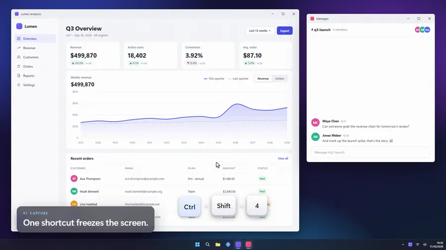

# Screenshot Studio

[](https://github.com/Boughzala-ayoub/screenshot-studio/actions/workflows/ci.yml)

A native Windows region screenshot, markup, and H.264/MP4 screen-recording utility built with **Tauri v2 (Rust + WebView2)** and **TypeScript**. Press a global hotkey, freeze every monitor, drag a pixel-exact region with an 8× color loupe, annotate or redact inline, and drag the pinned preview straight into any app or terminal.

<p align="center">
  
</p>

## Key Features

- **Cross-Monitor Region Capture (`Ctrl+Shift+4`)** — Composites every connected monitor into one frozen frame (`xcap`), paints the overlay via uncompressed BMP to avoid PNG encode latency on capture, and provides an **8× pixel loupe** with live `#hex` readout, arrow-key micro-nudging, and `Space`-to-reposition.
- **8-Tool Canvas 2D Markup Editor** — Rectangle (`R`), Ellipse (`E`), Arrow (`A`), Pen (`P`), Highlight (`H`), Text (`T`), Numbered Step badges (`N`), and Pixelate redaction (`B`), with 7 colors, 3 stroke widths, undo/redo, and atomic temp-file saves guarded by edit-session IDs.
- **Native Region Video Recording (`Ctrl+Shift+5`)** — Uses **Windows Graphics Capture** (`windows-capture`) on the selected monitor, crops to even H.264 dimensions, and encodes silent 30 fps **H.264/MP4** via Windows Media Foundation (`1–12 Mbps` area-scaled bitrate) with pause/resume timestamp continuity and a click-through border indicator.
- **Dual Always-On-Top Pins** — Independent floating preview windows for stills and MP4 recordings (played straight from disk via Tauri's `protocol-asset` range requests), with history navigation, one-click copy, and retake.
- **Win32 COM/OLE Drag-Out (`dragout.rs`)** — Custom `IDataObject` offering both `CF_HDROP` (file drop for chat apps, browsers, and Explorer) and quoted `CF_UNICODETEXT` (file path for terminals and CLI prompts), paired with a shell drag thumbnail (`SHDRAGIMAGE`).
- **Ticket-Ordered Clipboard & Customizable Settings** — Monotonic clipboard tickets ensure a slower background copy never overwrites a newer shot; shortcuts and Windows startup toggle save immediately.

## Architecture

| Layer | Implementation |
| --- | --- |
| **Desktop & Capture Core** | Rust (`src-tauri/src/lib.rs`) — Tauri v2 tray app, global hotkeys, multi-monitor `xcap` capture, atomic saves, clipboard ticket ordering |
| **Video Pipeline** | Rust (`src-tauri/src/record.rs`) — Windows Graphics Capture + Media Foundation H.264/MP4 encoder + pause timestamp tracking |
| **Native Drag-Out** | Rust (`src-tauri/src/dragout.rs`) — Win32 COM `IDataObject` (`CF_HDROP` + `CF_UNICODETEXT`) and `IDragSourceHelper` |
| **UI Windows** | Vanilla TypeScript + Vite (`overlay`, `editor`, `preview`, `settings`) — zero frontend framework runtime overhead |

## Build from Source

Requires **Windows 10/11**, **Node.js 20+**, and **Rust (MSVC toolchain)**.

```sh
npm install
npm run tauri dev     # run locally with hot reload
npm run tauri build   # production build + Windows installer
```

## Verification

```sh
npm run build                        # TypeScript typecheck + Vite bundle
cargo test --manifest-path src-tauri/Cargo.toml
npm run verify:overlay               # Headless Chrome CDP checks across 7 viewports
```

Additional Windows verification scripts live in the repo root (`verify-capture.ps1`, `verify-coldstart.ps1`, `verify-video.ps1`, `verify-idle.ps1`).

## License

[MIT](LICENSE)
